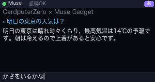
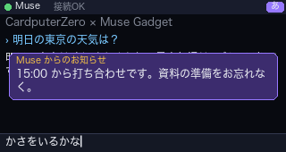

# cardputer-zero-muse-gadgets

M5Stack **CardputerZero** を Meta の **Muse** と話せる「Muse Gadget」にするアプリです。
キーボードで打った文章を Muse に送り、返答を 320×170 の画面に表示します。
Muse 側からも、カスタムコマンドで CardputerZero の画面にメッセージを出せます。

 

> 非公式プロジェクトです。Meta / M5Stack とは関係がなく、承認も受けていません。

## しくみ

```
 Muse アプリ / Muse VM
        ▲  BLE ペアリング / WSS + Noise（暗号化）
        │
 ┌──────┴──────────────── CardputerZero (Raspberry Pi CM0, Linux) ┐
 │ musegadget サービス（Muse Gadgets Linux SDK, systemd, root）     │
 │   ├─ /run/musegadget/musegadget.sock  ← テキスト送信・返答待ち     │
 │   └─ /etc/musegadget/commands.d/cardputer.*.json → czmuse-command │
 │                                                     │            │
 │ czmuse（このアプリ, APPLaunch から起動）                │            │
 │   ├─ /dev/fb0 に描画（Pillow → RGB565）                 │            │
 │   ├─ /dev/input のキーボード（evdev）                    │            │
 │   └─ /tmp/czmuse-notify.sock ◀───────────────────────┘            │
 └──────────────────────────────────────────────────────────────────┘
```

| 担当 | 内容 |
|---|---|
| **SDK**（[facebookincubator/muse-gadget-sdk](https://github.com/facebookincubator/muse-gadget-sdk) の `linux/`） | ペアリング、暗号化通信、再接続、トークン更新、返答待ち、カスタムコマンドの実行 |
| **このリポジトリ** | 320×170 の画面、キーボード入力、ローマ字かな入力、CardputerZero 用カスタムコマンド、APPLaunch 用 `.deb` |

SDK のサービスにはローカルソケット経由で話しかけるだけなので、SDK 本体には手を入れていません。

## 機能（v0.1）

- キーボードでチャット（返答は折り返して表示、↑↓でスクロール）
- **Tab でローマ字かな入力**（`konnichiha` → こんにちは）。漢字変換はありませんが、Muse はひらがなで問題なく理解します
- Muse から呼べるコマンド
  - `cardputer.screen.show` … 画面にお知らせをポップアップ（例:「CardputerZero に『15時から会議』と出して」）
  - `cardputer.status.read` … バッテリー残量とアプリが開いているかを返す
- 接続状態の表示（緑: 接続OK / 黄: 考え中 / 赤: サービス未起動・未接続）

### キー操作

| キー（CardputerZero） | 動作 |
|---|---|
| OK（Enter） | 送信 |
| TAB | 英数 ⇄ ローマ字かな |
| fn+F / fn+X（▲▼） | スクロール |
| fn+L / fn+M（PgUp / PgDn） | ページ送り |
| ESC | 入力を消す |
| fn+H（HELP） | ヘルプ |
| ctrl+L | 表示をクリア |
| ctrl+Q | 終了 |

## 実機で使う

手順は [docs/DEVICE_SETUP.md](docs/DEVICE_SETUP.md) を見てください。概要:

1. [gadgets.muse.ai](https://gadgets.muse.ai/settings/sdk-tokens) で SDK トークン（`mgst_…`）を発行
2. CardputerZero に SDK を入れてペアリング（`install.sh --sdk-token …`）
3. このアプリの `.deb` を入れて、ランチャーから「Muse Gadget」を起動

SDK トークンはこのリポジトリにも `.deb` にも含まれません。各自が自分のトークンを実機に入れます（[SDK Terms](https://gadgets.muse.ai/sdk-terms) 準拠）。

## 開発（Mac / PC）

[uv](https://docs.astral.sh/uv/) を使います。

```bash
uv sync
uv run czmuse --mock          # 画面を3倍に拡大したウィンドウで、ダミーの Muse と会話
uv run pytest                 # テスト
uv run scripts/screenshots.py # screenshots/*.png を再生成
uv run scripts/build_deb.py   # dist/cz-muse-gadget_<ver>_arm64.deb を作る（dpkg 不要）
```

`--mock` なしで Mac から動かすと、musegadget サービスのソケットがないので「サービスが動いていません」と表示されます。

主なオプション:

- `--session-id NAME` … Muse のメインチャットではなくサイドチャットを使う
- `--wait 秒` … 返答を待つ最大時間（既定 180 秒）
- `--kana` … ローマ字かなモードで起動
- `--debug-keys` … 実機で押したキーの evdev コードを stderr に出す

## 構成

```
src/czmuse/
  __main__.py   起動・引数
  app.py        状態管理とキー操作
  render.py     320x170 の描画（Pillow）
  display.py    framebuffer + evdev / Tk ウィンドウ / ヘッドレス
  keys.py       evdev キーコード → 文字
  romaji.py     ローマ字 → ひらがな
  muse.py       musegadget サービスのソケットクライアント（とモック）
  notify.py     カスタムコマンド → 画面 への中継ソケット
  command.py    czmuse-command（Muse のカスタムコマンド本体）
commands.d/     /etc/musegadget/commands.d に入るコマンド定義
packaging/      アイコン、postinst/postrm、依存パッケージ
scripts/        .deb ビルド、スクリーンショット、アイコン生成
app-builder.json  CardputerZero AppStore 用マニフェスト
```

## ライセンス

MIT
